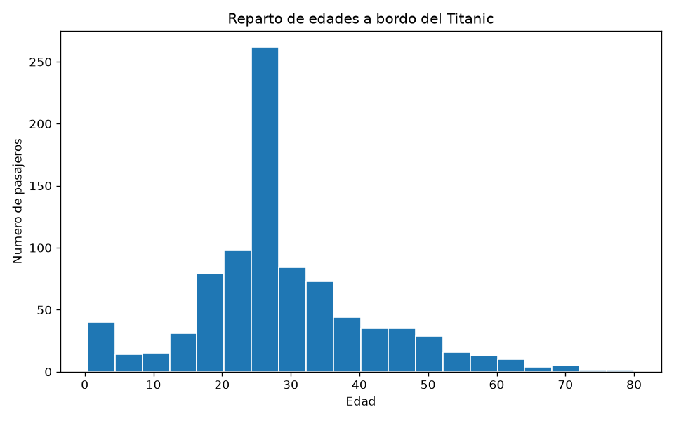
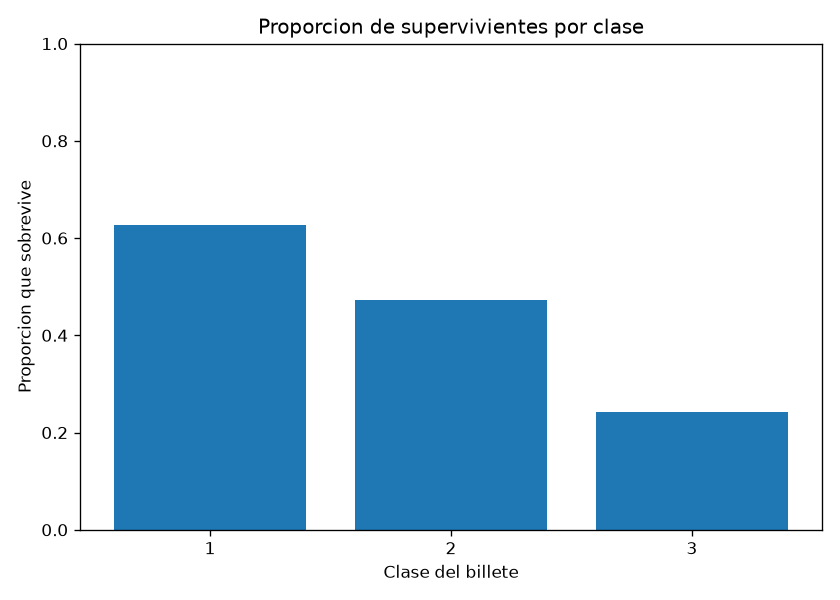
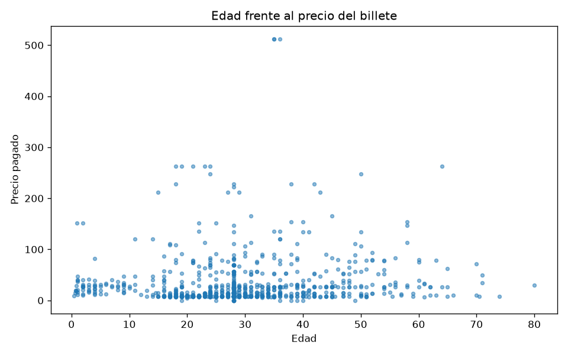

# Lab 03 · Visualización con matplotlib

> Anterior: [lab 02 · Limpieza de datos](../02-limpieza-datos/)
> Teoría: [apuntes/03-visualizacion.md](../../apuntes/03-visualizacion.md)

## Objetivo

Mirar el Titanic ya limpio con los tres gráficos que contestan a las tres preguntas básicas, y
escribir debajo de cada uno **qué se ve** — que es el ejercicio de verdad. Un gráfico sin lectura
es decoración.

Para un perfil que va a MLOps, mirar los datos no es cosa de data scientist: es lo que detecta el
problema evidente antes de entrenar, y es el embrión del panel que vigila la deriva de un modelo
en producción (dos distribuciones comparadas).

## Cómo se ejecuta

```bash
source .venv/bin/activate        # el entorno con pandas y matplotlib
python3 graficos.py
```

Necesita `titanic_limpio.csv` (salida del [lab 02](../02-limpieza-datos/)) en la misma carpeta. El
dataset es el de **seaborn**, no el de Kaggle: columnas en minúsculas (`age`, `pclass`, `survived`,
`fare`).

## Los tres gráficos

### 1. Reparto de edades



<<PEGA AQUÍ qué ves. Pista: hay un pico antinatural sobre los 28 años. Lo pusiste tú al rellenar
los nulos de edad con la mediana en el lab 02 — 177 edades vacías pasaron a valer todas 28. No es
un dato del Titanic, es tu decisión de limpieza hecha visible.>>

### 2. Supervivencia por clase



```
pclass
1    0.626168      62,6 %
2    0.472826      47,3 %
3    0.242363      24,2 %
```

### 3. Edad frente al precio del billete



```
     pclass   age      fare  survived
257       1  35.0  512.3292         1
678       1  36.0  512.3292         1
736       1  35.0  512.3292         1
27        1  19.0  263.0000         0
87        1  23.0  263.0000         1
```

> Esos valores extremos son los que torcerían un modelo que asume escala lineal: candidato a
> transformación logarítmica el día que entrene.

## Lo que aprendí

- **`Figure` es el lienzo, `Axes` es el gráfico.** `Axes` no significa "los ejes"; esos son `Axis`.
- **Siempre `fig, ax = plt.subplots()`**, nunca `plt.hist()` suelto: la forma implícita actúa sobre
  "el gráfico actual", que es estado global invisible.
- **`matplotlib.use("Agg")` antes de importar pyplot**: dibuja a fichero sin abrir ventana, que es
  la única forma de que esto funcione dentro de un contenedor o en un pipeline.
- **La media de una columna de 0 y 1 es la proporción.**
- **`set_ylim(0, 1)` en una proporción** evita exagerar una diferencia pequeña.
- **`alpha` en una dispersión** convierte una mancha en información.
- **Nunca asumas el esquema de un CSV: míralo primero.** Ver el punto siguiente.

## Errores con los que me topé

- **El entorno no estaba activado.** `python3` no veía pandas hasta hacer `source .venv/bin/activate`.
  Las librerías viven en el entorno virtual, no en el sistema.
- **matplotlib no estaba instalado** en el entorno (venía solo de pandas del lab 02).
  `pip install matplotlib` y después `pip freeze > requirements.txt` para que quede registrado:
  si no, quien clone el repo se cae igual que me caí yo.
- **`KeyError: 'Age'`.** El script asumía los nombres de columna de Kaggle (`Age`, `Pclass`...),
  pero mi CSV es el de seaborn, en minúsculas (`age`, `pclass`...). Lo resolví mirando las columnas
  reales con `pd.read_csv(...).columns` antes de volver a confiar en ellas. **Código que asume
  nombres de columna se rompe en cuanto el esquema cambia; en un pipeline pasa constantemente.**

## Qué queda pendiente a propósito

- **seaborn**, que hace en una línea lo que aquí cuesta cinco. A propósito: entender `Figure` y
  `Axes` a pelo primero hace que seaborn después se entienda en diez minutos.
- **Dos histogramas superpuestos** para comparar distribuciones, que es cómo se detecta la deriva
  de un modelo en producción. Pertenece al tramo de MLOps.
- **El primer modelo con scikit-learn** sobre este mismo dataset: el siguiente de la ruta.